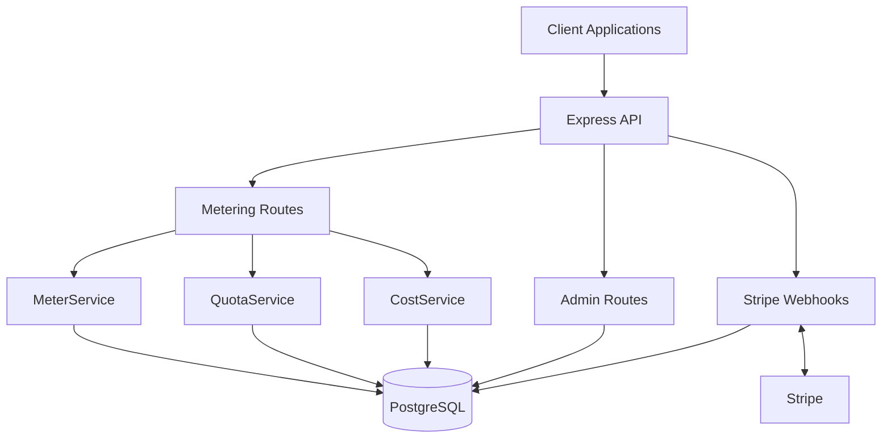
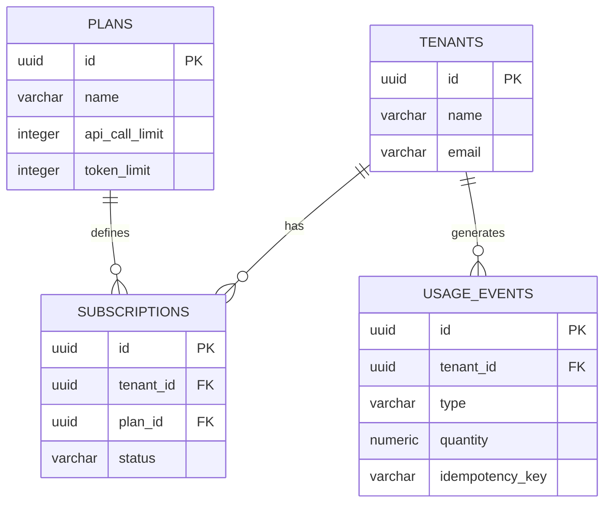

# BillFlow — Design Document

## 1. Overview

BillFlow is a multi-tenant usage metering and subscription billing backend for SaaS applications.

The system tracks API usage and AI token consumption, manages subscription quotas, calculates usage costs, and integrates with Stripe for subscription management.

The main objective is to provide a centralized billing system that SaaS applications can integrate into their platforms.

## 2. System Architecture

BillFlow follows a modular monolithic architecture using Node.js and Express.

The application is divided into separate modules, each responsible for a specific functionality.



### Main Components

| Component | Responsibility |
|---|---|
| Express API | Handles incoming HTTP requests |
| MeterService | Records and manages usage events |
| QuotaService | Checks subscription usage limits |
| CostService | Calculates AI token usage costs |
| Stripe Webhooks | Synchronizes subscription information |
| Admin Routes | Provides usage and revenue analytics |
| PostgreSQL | Stores application and billing data |

## 3. Project Structure

```text
BillFlow/
│
├── config/          # Database and Stripe configuration
├── routes/          # API endpoints and webhook handlers
├── services/        # Core billing business logic
├── sql/             # Database schema and seed scripts
├── Evidence/        # Project testing evidence
│
├── server.js        # Application entry point
├── docker-compose.yml
├── package.json
├── .env.example
├── README.md
└── DESIGN.md
```

## 4. Database Design

BillFlow uses PostgreSQL as its primary database.

The main entities are:

| Entity | Description |
|---|---|
| Tenants | Stores organization and customer information |
| Plans | Defines subscription plans and usage limits |
| Subscriptions | Connects tenants with their selected plans |
| Usage Events | Stores API and AI token consumption records |
| Processed Stripe Events | Tracks processed webhook events |

### Entity Relationships



## 5. Core Workflows

### 5.1 Usage Metering

1. A client sends a usage request with a tenant ID and usage details.
2. The API validates the incoming request.
3. QuotaService checks the tenant's subscription limits.
4. MeterService records the usage event.
5. An idempotency key prevents duplicate usage records.
6. The API returns the usage information.

### 5.2 AI Token Cost Calculation

BillFlow tracks different AI token categories:

- Input tokens
- Cached input tokens
- Output tokens
- Reasoning tokens

Each category has a separate pricing rate.

The total cost is calculated as:

\[
TotalCost = InputCost + CachedCost + OutputCost + ReasoningCost
\]

### 5.3 Stripe Subscription Management

1. A customer completes the subscription checkout process.
2. Stripe sends a webhook event to BillFlow.
3. BillFlow verifies the webhook signature.
4. The webhook handler checks whether the event was already processed.
5. Subscription information is updated in PostgreSQL.
6. The processed event ID is stored to prevent duplicate processing.

## 6. Technology Choices

| Technology | Why It Is Used |
|---|---|
| Node.js | Backend runtime |
| Express 5 | REST API development |
| PostgreSQL | Relational database and persistent storage |
| Stripe | Payment and subscription management |
| Docker | Database containerization |
| JavaScript | Backend application development |

---

**Project:** BillFlow — Usage Metering & Billing Engine

**Author:** Adarsh Bhandari

**Repository:** https://github.com/Adarsh-bhandari1/BillFlow