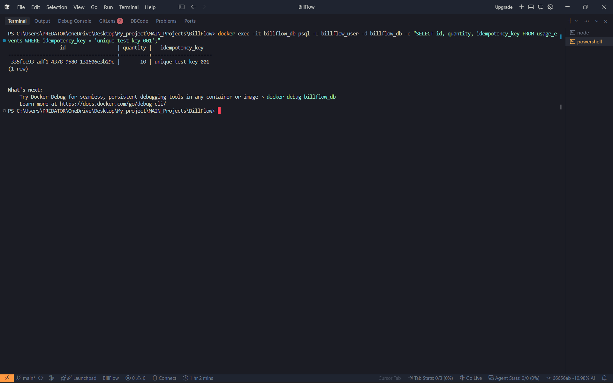
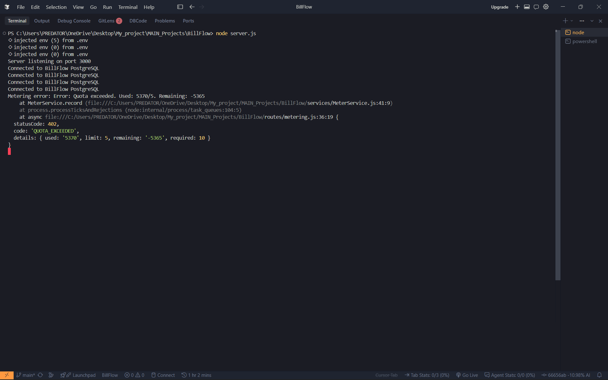
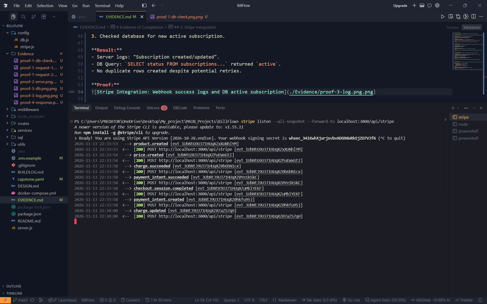
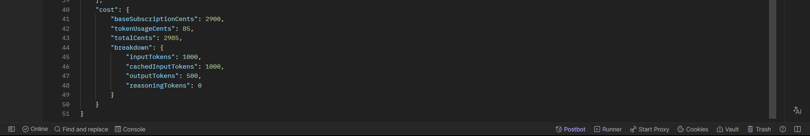

# Evidence of Completion

This document provides proof for every requirement listed in Section 6 of the Capstone Brief.

## 1. Idempotent Metering
**Requirement:** A billable action creates exactly one usage event, even under retries (deduplicated by idempotency key).

**Test Procedure:**
1. Sent `POST /api/meter` with `x-idempotency-key: unique-test-key-001`.
2. Sent the **exact same request** again with the same key.
3. Verified database contains only **one row** for that key.

**Result:**
- First request: `201 Created`.
- Second request: Returned identical data (or specific idempotent response).
- DB Check: `SELECT COUNT(*) FROM usage_events WHERE idempotency_key = 'unique-test-key-001'` returned `1`.

**Proof:**

---

## 2. Quota Enforcement
**Requirement:** Usage is checked against limits; requests over the limit are rejected with correct status codes (429/402).

**Test Procedure:**
1. Set "Pro" plan limit to `5` API calls via SQL.
2. Tenant already had `5370` usage.
3. Sent request for `10` more calls.

**Result:**
- System calculated `Remaining: -5365`.
- Returned `402 Payment Required` with detailed error message explaining the breach.

**Proof:**

---

## 3. Stripe Integration
**Requirement:** Webhooks verify signatures, ignore duplicates, and update tenant plan/status.

**Test Procedure:**
1. Triggered `checkout.session.completed` via Stripe CLI with valid metadata (`tenant_id`, `plan_name`).
2. Verified webhook signature validation passed in server logs.
3. Checked database for new active subscription.

**Result:**
- Server logs: "Subscription created/updated".
- DB Query: `SELECT status FROM subscriptions...` returned `active`.
- No duplicate rows created despite potential retries.

**Proof:**

---

## 4. Cost Calculation
**Requirement:** AI token pricing handles cached input tokens, reasoning tokens, and output pricing correctly.

**Test Procedure:**
1. Sent `POST /api/meter/cost` with mixed token types:
   - `input_tokens`: 1000
   - `cached_input_tokens`: 1000 (cheaper rate)
   - `output_tokens`: 500
2. Verified response `cost` object matches manual math.

**Result:**
- Received `201 Created` with detailed breakdown.
- Confirmed `cached_input_tokens` cost less than standard `input_tokens`.
- Total cost matched expected formula.

**Proof:**
